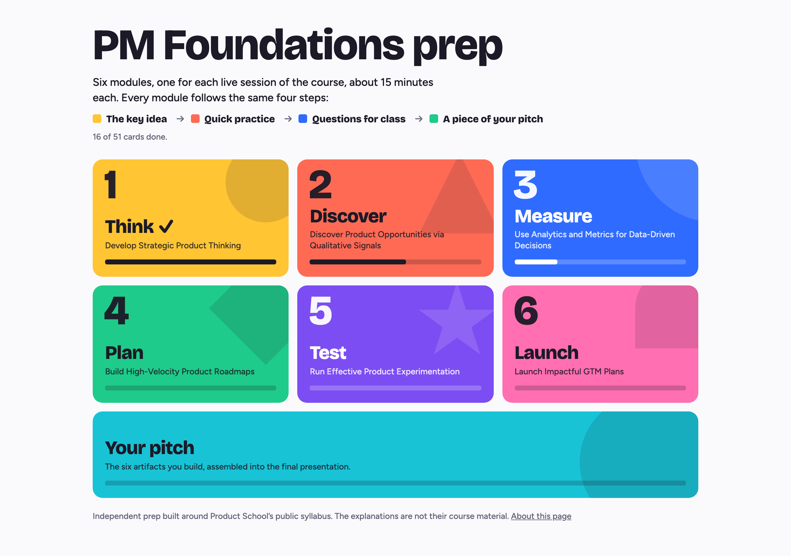
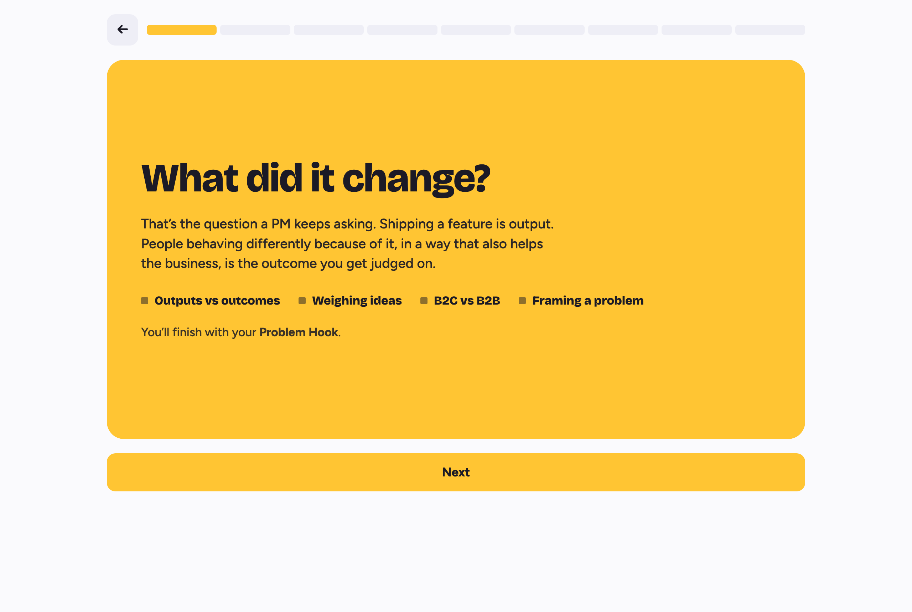
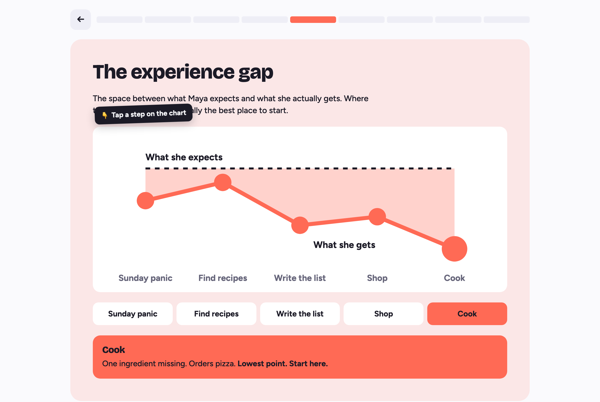
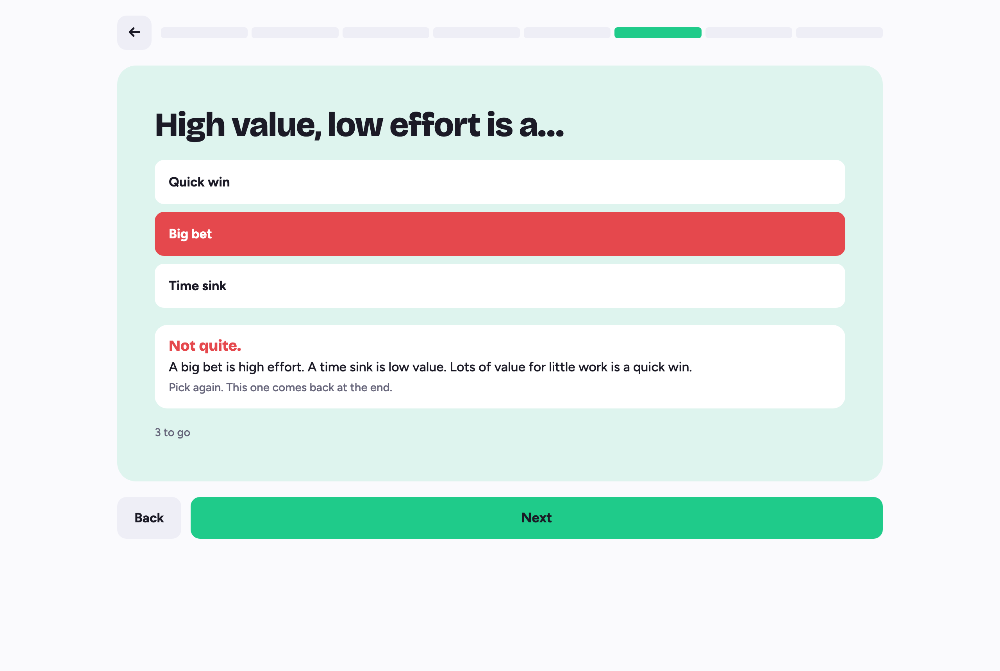
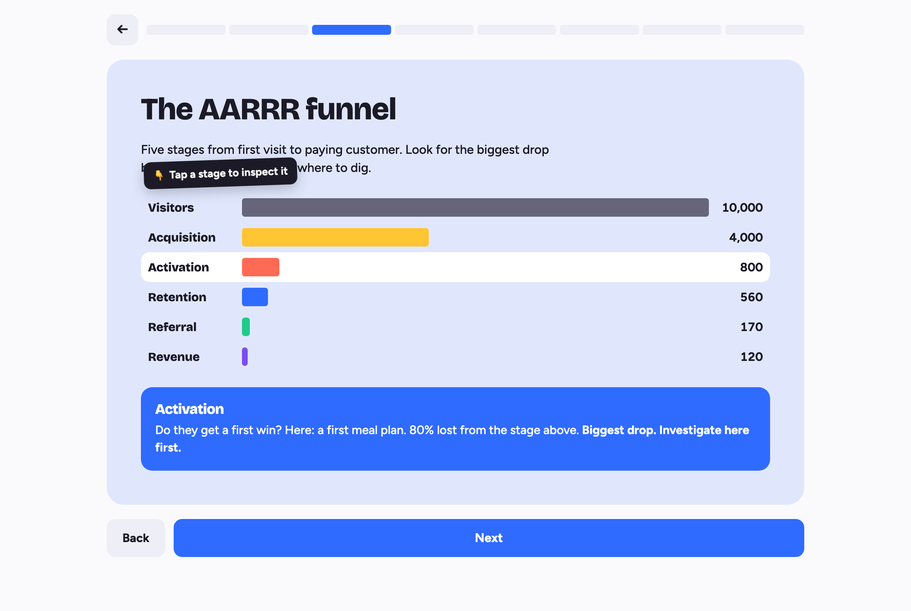
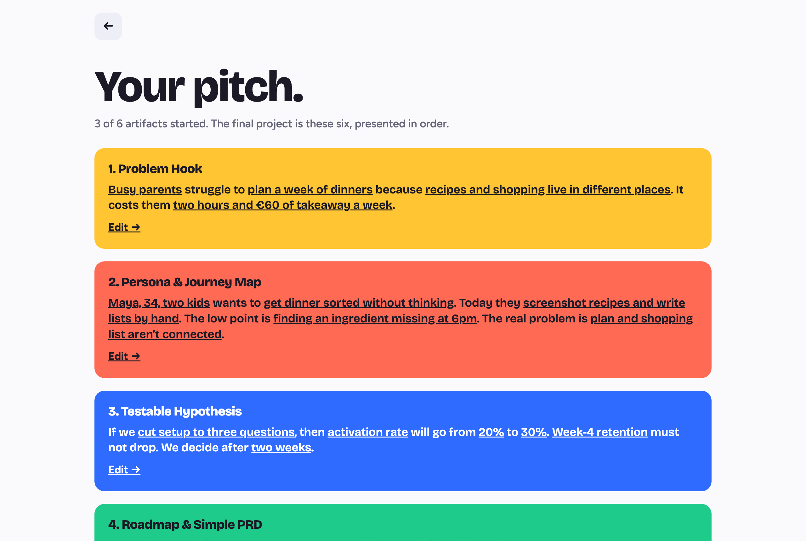
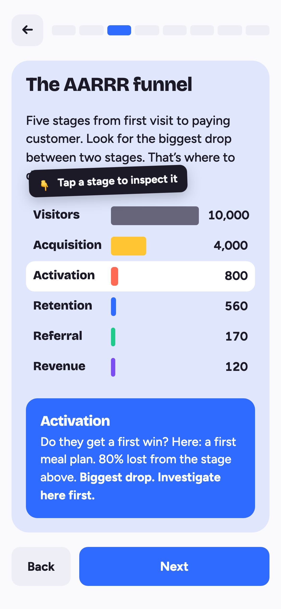

# PM Foundations Prep

**▶ Try it: [pm-prep.playhz.com](https://pm-prep.playhz.com)**

A friend enjoyed Product School's [Product Management Foundations](https://productschool.com/courses/product-management-certification) course and recommended it to me. I built this small prep tool to get a feel for what's covered there before the live sessions, so class time can go to questions and people instead of definitions.

It's short on purpose: one idea per card, lots of tapping and sorting, very little reading. It was designed with an ADHD brain in mind.



## How it's structured

Six modules, one for each live session in the course syllabus, about 15 minutes each:

| # | Module | Covers | You build |
|---|---|---|---|
| 1 | Think | Outputs vs outcomes, weighing ideas, B2C vs B2B | Problem Hook |
| 2 | Discover | Workarounds, personas, journey maps, the experience gap | Persona & Journey Map |
| 3 | Measure | Vanity vs strategic metrics, the AARRR funnel, hypotheses | Testable Hypothesis |
| 4 | Plan | Effort vs value, Now/Next/Later, MoSCoW, a one-page PRD | Roadmap & Simple PRD |
| 5 | Test | Six test methods and when to use each | Experiment Brief |
| 6 | Launch | GTM choices, launch size, channels, phased rollout | GTM Launch Plan |

Every module follows the same four steps: **the key idea → quick practice → questions for class → a piece of your pitch.** At the end, the six pieces come together on one page, like the course's final presentation.

<p>
  
  
</p>

## What's in it

- **Sorting games and quizzes.** When you get one wrong you see why, and that item comes back at the end of the round.
- **Interactive diagrams** for the journey map, the AARRR funnel and picking a test method.
- **Builders** that turn a few short answers into each artifact, carried through all six modules with one product idea.
- **Questions to bring to class** at the end of every module.
- Progress and answers are saved in your browser. Nothing is sent anywhere.

<p>
  
  
</p>

<p>
  
  
</p>

## Run it yourself

It's a single HTML file with no build step and no dependencies apart from Google Fonts.

```bash
git clone https://github.com/steefvw/productschoolprep
cd productschoolprep/wifi
python3 -m http.server 8000   # then open http://localhost:8000
```

- `index.html` is the source.
- `wifi/index.html` is the same page wrapped as a standalone document. That's the copy that gets hosted.

## Note

This is an independent study aid, not affiliated with Product School. It follows the module titles from their public syllabus, but all explanations, examples and exercises are my own and are not their course material.
